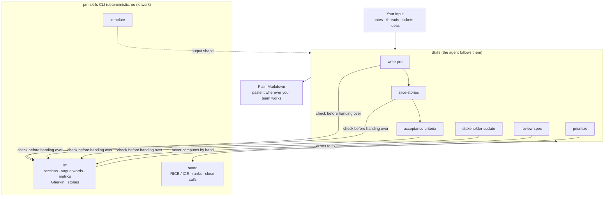

# product-management-skills

**Product management skills for AI coding agents, with a linter that keeps them honest.** Six skills for Claude Code and Codex turn rough notes into a PRD, slice it into stories, write Given/When/Then criteria, rank a backlog with RICE or ICE, write stakeholder updates and review specs. A small CLI checks the wording and does the arithmetic, so the output is something a team can build from.

English | [Türkçe](README.tr.md)

[](https://github.com/Tngc93/product-management-skills/actions/workflows/ci.yml)
[](LICENSE)


<picture>
  <source media="(prefers-color-scheme: dark)" srcset="docs/assets/how-it-works-dark.svg">
  
</picture>

```text
$ pm-skills lint examples/before/weak-prd.md
examples/before/weak-prd.md (prd)
  error       Missing section: Problem.  [missing-section]
  error       Missing section: Non-goals / out of scope.  [missing-section]
  warn     5  "seamless" can't be checked by anyone.  [vague-word]
             → say which handoff stops failing
  error    9  Success metric without a number.  [metric-without-number]
             → Write metric, baseline, target and date: "checkout conversion 2.1% → 2.5% by 30 Nov".
  error   22  Scenario missing When: Scenario: Estimate is shown  [gherkin-incomplete]
  …
  6 errors, 8 warnings
```

## Why

A language model writes a fluent PRD in seconds. Fluent is not the same as buildable: "make checkout faster and more intuitive", a success metric with no baseline, a scenario with no action, a RICE table whose multiplication is off. These are the mistakes a senior PM catches in review, and they are mostly mechanical.

So this package splits the work:

- **Skills** carry the method: what to ask before writing, which sections a PRD needs, how to slice vertically with SPIDR, how to find edge cases, how to write for an executive who skims.
- **A deterministic CLI** checks what can be checked: missing sections, vague words with a concrete rewrite for each, metrics without a number, baseline or date, Gherkin scenarios without Given, When or Then, stories without "so that". It also does all RICE and ICE arithmetic, because ranking should never depend on a model multiplying correctly.

Everything is plain Markdown. Nothing is sent anywhere, and no project-management tool is required: paste the output wherever your team works.

## The skills

| Skill | Use it to | Output |
| --- | --- | --- |
| `write-prd` | Turn notes, threads or an idea into a one-page PRD. Asks at most three questions first; never invents numbers. | Problem with evidence, users, metric table (baseline, target, date, guardrail), non-goals, numbered requirements, rollout, open questions with owners |
| `slice-stories` | Break an epic or PRD into thin vertical slices using SPIDR (paths, interfaces, data, rules, spikes). | Slice table with split method and release, one story per slice with "so that", INVEST check |
| `acceptance-criteria` | Write Given/When/Then scenarios for a story, including boundaries, errors, permissions and non-functional checks. | Gherkin feature (English or Turkish keywords) and open questions |
| `prioritize` | Rank items with RICE or ICE, with a reason for every estimate. The script computes and ranks. | Ranked table, close calls, the estimates the ranking is most sensitive to |
| `stakeholder-update` | Write a status update that leads with status, change and asks. | Status, TL;DR, progress with numbers, next, risks, asks |
| `review-spec` | Review a document as an engineer, a designer and an executive. | Blocking / important / minor findings with rewrites, lint results, three questions |

Each skill writes in the language you use. The linter understands English and Turkish: vague words, section names, Gherkin keywords and time expressions in both.

## Install

Needs **Node.js 18.17+**. No dependencies.

### Claude Code plugin

```text
/plugin marketplace add Tngc93/product-management-skills
/plugin install product-management-skills@product-management-skills
```

Then ask naturally: *"turn these notes into a PRD"*, *"slice this epic"*, *"rank these five ideas with RICE"*, *"write acceptance criteria for story 2"*, *"weekly update for leadership from this list"*, *"review this spec"*.

### Codex

The repository ships `.codex-plugin/plugin.json` with the same six skills for Codex plugin marketplaces. You can also copy the folders under `skills/` into the folder your Codex version loads skills from.

### CLI only

```bash
npx github:Tngc93/product-management-skills lint my-prd.md
npx github:Tngc93/product-management-skills score backlog.md --write
npx github:Tngc93/product-management-skills template write-prd > prd.md
```

## The CLI

### `pm-skills lint <file or folder...>`

Detects the document type from front matter (`type: prd | stories | criteria | update | generic`) or the title, or take `--type`. Exit code 1 on errors, 0 otherwise; `--strict` also fails on warnings; `--json` for machines; `--ignore word,word` to accept a word this time. Add `<!-- pm-lint:ignore -->` to a line to skip it.

| Rule | Level | What it catches |
| --- | --- | --- |
| `missing-section` | error | PRD without problem, users, goals and metrics, non-goals, requirements or open questions; update without summary, progress, next, risks or asks |
| `metric-without-number` | error in PRDs | A success metric with no number |
| `gherkin-incomplete` | error | A scenario without Given (or Background), When or Then |
| `metric-without-baseline` | warn | A target with no current value to compare with |
| `metric-without-date` | warn | A target with no date or time window |
| `vague-word` | warn | "fast", "intuitive", "seamless", "improve", "etc." and their Turkish counterparts ("hızlı", "kullanıcı dostu", "sorunsuz", "vb."), each with a suggested rewrite |
| `criterion-not-testable` | warn | An acceptance criterion with "should" and nothing measurable |
| `story-without-value` | warn | "As a … I want …" without "so that" (or "böylece") |
| `story-too-big` | warn | A slice estimated above 8 points |
| `story-does-two-things` | warn | A slice title joining two behaviours with "and" |
| `placeholder` | warn | TODO, TBD, `???`, `<target>` and friends |

### `pm-skills score <file>`

Finds the first table with Reach, Impact, Confidence and Effort columns (RICE) or Impact, Confidence and Ease (ICE), in English or Turkish, and ranks it.

```text
$ pm-skills score examples/good/backlog-rice.md
RICE ranking (reach × impact × confidence ÷ effort)

| Rank | Item | Reach | Impact | Confidence | Effort | RICE score |
| --- | --- | --- | --- | --- | --- | --- |
| 1 | Delivery window on product page | 2,300,000 | 2 | 80% | 6 | 613,333 |
| 2 | Search results under 300 ms | 1,900,000 | 0.5 | 80% | 5 | 152,000 |
| 3 | Pay in instalments at checkout | 160,000 | 2 | 80% | 4 | 64,000 |
| 4 | Saved carts across devices | 410,000 | 1 | 50% | 8 | 25,625 |
| 5 | Room planner in 3D | 90,000 | 3 | 50% | 20 | 6,750 |
```

It reads `12,000`, `12.000`, `12k`, `80%`, `0.8` and `80`; rejects impact off the RICE scale and ICE values outside 1 to 10; questions confidence above 80% (use `--allow-high-confidence` when you have data); and lists pairs within 10% of each other as too close to call. `--write` adds Score and Rank columns to your table in place.

### `pm-skills template <skill>`

Prints the Markdown template a skill fills in.

## How it fits together



## Examples

[`examples/`](examples) follows one fictional feature, a delivery-date window for an online furniture store, from [meeting notes](examples/before/meeting-notes.md) to a [PRD](examples/good/prd-delivery-estimate.md), [stories](examples/good/stories-delivery-estimate.md), [acceptance criteria](examples/good/criteria-delivery-window.md), a [RICE ranking](examples/good/backlog-rice.md) and a [status update](examples/good/update-week-42.md). Every file in `examples/good/` passes the linter; [`examples/before/weak-prd.md`](examples/before/weak-prd.md) shows what it catches.

## Limitations

- The linter checks form, not judgment. A PRD can pass and still solve the wrong problem; that is what `review-spec` and your team are for.
- Vague-word detection is a word list. It will sometimes flag a word used precisely ("significant" in a statistics sense): fix the wording, or mark the line with `pm-lint:ignore`.
- RICE and ICE are only as good as their inputs. The script makes the inputs visible and the arithmetic correct; it does not make the estimates right.

## Development

```bash
npm test                # node:test, no dependencies
npm run lint:examples   # every file in examples/good must pass
```

The repository's own [AGENTS.md](AGENTS.md) is generated and kept current with [repo-onboarding](https://github.com/Tngc93/repo-onboarding).

## License

MIT © Berk Arcak
